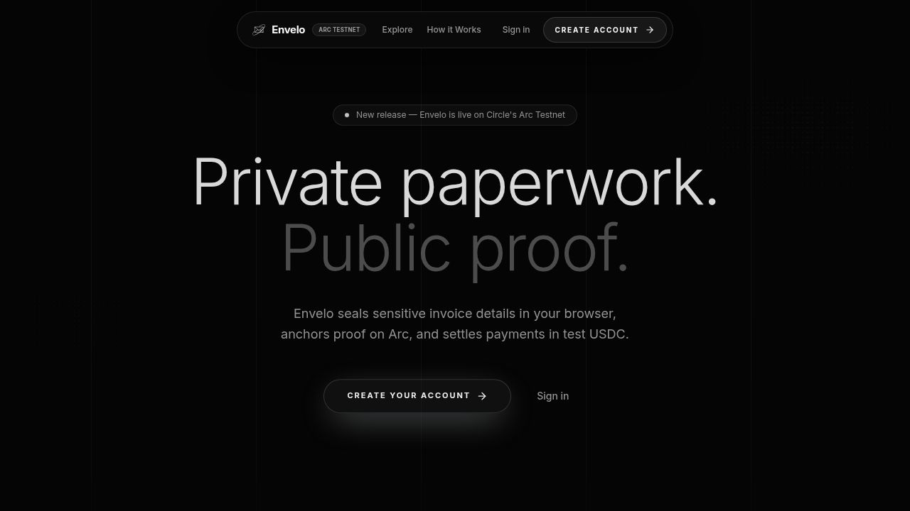
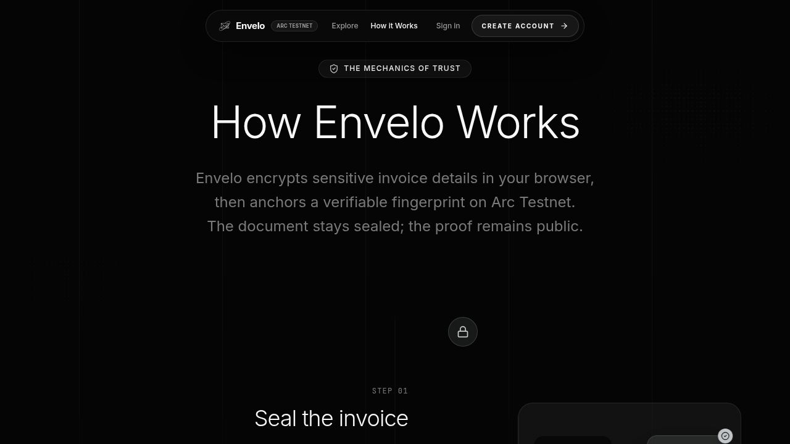

# Envelo

**Private paperwork. Public proof.**

Envelo is a privacy-first invoicing platform built on Circle's Arc. Invoice details are sealed (encrypted) in the sender's browser before they ever leave the device, a tamper-evident fingerprint of every invoice is anchored on-chain, and payments settle in USDC. Only the parties to an invoice can open the envelope — everyone else can still verify the proof.

Envelo runs on two networks from one codebase, and every invoice is pinned to one of them:

| | Sandbox | Live |
| --- | --- | --- |
| Network | Arc Testnet (5042002) | Arc Mainnet (5042) |
| Money | free test USDC | real USDC, paid from the client's own wallet |
| Anchor fee | paid by the sender | paid by Envelo's operator wallet |
| Registry v4 | [`0xde05…e51d`](https://explorer.testnet.arc.io/address/0xde0565b22c4451e714c81f5a0ce5f83b6d11e51d) | [`0xa27c…e338`](https://explorer.arc.io/address/0xa27cc871eee4a86ed5c5cb3f11315bff4ca2e338) |

> Live invoicing is off unless `ARC_MAINNET_ENABLED=true`, an operator key and a registry are configured. Envelo never holds payment funds: the registry forwards each payment to the sender's own wallet in the same transaction. See [docs/arc-mainnet.md](docs/arc-mainnet.md).

---

## Screenshots

| Landing | How it works |
| --- | --- |
|  |  |

## How it works

| Step | What happens | Where |
| --- | --- | --- |
| 1. Seal | Invoice details are encrypted with AES-256-GCM before leaving the device | Browser |
| 2. Anchor | A SHA-256 fingerprint of the invoice (with a random nonce) is committed on-chain | Arc |
| 3. Settle | The client pays in USDC; the registry checks payee and amount, then forwards it | Arc |
| 4. Verify | Anyone can check integrity against the anchor — without seeing the contents | Public |

### Trust boundary

| Zone | Sees plaintext | Stores |
| --- | --- | --- |
| Your browser | Yes | Envelope keys (client-side) |
| API server | No | Ciphertext + routing metadata only |
| Arc | No | Fingerprints and USDC transfers only |

## Repository structure

```
.
├── artifacts/
│   ├── sealed-invoices/   # Web app — React + Vite (marketing site + signed-in dashboard)
│   ├── api-server/        # Node.js API server (TypeScript)
│   ├── mobile/            # Expo (React Native) companion app
│   ├── arc-pitch-deck/    # Investor pitch deck (web slides)
│   └── demo-video/        # Animated product demo (web)
├── lib/
│   ├── api-spec/          # OpenAPI specification (single source of truth for the API)
│   ├── api-zod/           # Zod schemas generated from the spec
│   ├── api-client-react/  # Typed React client hooks
│   └── db/                # Drizzle ORM schema + migrations
├── package.json           # pnpm workspace root
└── pnpm-workspace.yaml
```

## Tech stack

- **Frontend** — React 18, Vite, Tailwind CSS v4, shadcn/ui, framer-motion
- **Backend** — Node.js (Express) + TypeScript, PostgreSQL with Drizzle ORM
- **Auth** — Clerk
- **Chain** — Arc Testnet (sandbox) and Arc Mainnet (live), USDC as native currency, viem
- **Mobile** — Expo / React Native
- **Quality** — Playwright end-to-end suite, Vitest, strict TypeScript across the workspace

## Getting started

### Prerequisites

- Node.js 20+
- pnpm 9+ (`corepack enable`)
- PostgreSQL database

### Install

```bash
pnpm install
```

### Environment variables

| Variable | Used by | Description |
| --- | --- | --- |
| `DATABASE_URL` | API server | PostgreSQL connection string |
| `CLERK_SECRET_KEY` | API server | Clerk backend key |
| `CLERK_PUBLISHABLE_KEY` | API server | Clerk frontend key (verification) |
| `VITE_CLERK_PUBLISHABLE_KEY` | Web app | Clerk frontend key |
| `PORT` | Every app | Port the dev server binds to (required) |
| `BASE_PATH` | Web apps | Base URL path, e.g. `/` |
| `ARC_MAINNET_ENABLED` | API server | `true` to allow live invoices on Arc Mainnet |
| `ARC_MAINNET_OPERATOR_PRIVATE_KEY` | API server | Secret. The registry's anchorer; pays live anchor fees |
| `ARC_MAINNET_OPERATOR_MIN_BALANCE_USDC` | API server | Optional. Operator floor, default `1` |
| `ARC_MAINNET_DAILY_INVOICE_CAP` | API server | Optional. Live invoices per sender per 24h, default `10` |
| `ARC_MAINNET_HOURLY_INVOICE_CAP` | API server | Optional. Live invoices across all senders per hour, default `60` |

### Run

```bash
# Push the database schema
DATABASE_URL=... pnpm --filter @workspace/db push

# API server
PORT=3001 pnpm --filter @workspace/api-server dev

# Web app
PORT=5000 BASE_PATH=/ pnpm --filter @workspace/sealed-invoices dev
```

Each artifact has its own README with details.

## Testing

```bash
pnpm run typecheck                                     # strict TS across the workspace
pnpm --filter @workspace/api-server test               # API unit tests (Vitest)
pnpm --filter @workspace/sealed-invoices test:e2e      # Playwright end-to-end suite
pnpm run build                                         # full workspace build
```

## Key features

- Client-side sealing — invoice details are encrypted before anything is stored
- On-chain anchoring — anyone can verify an invoice's fingerprint without seeing its contents
- Payment bound to the invoice — the v4 registry only accepts the exact payee and amount committed at anchoring
- Sandbox with test USDC deposits, withdrawals, and wallet management; live mode paid from the client's own wallet
- Envelope key lifecycle — backup, restore, rotation, and lost-key reset
- Keep-a-copy proof file that can be verified against Arc without Envelo
- Full e2e regression suite covering sealing, anchoring, settlement, and key flows

---

*Payment amounts and wallet addresses are public on Arc once an invoice is paid; only the invoice body is encrypted. Envelo has not had an external security audit.*
